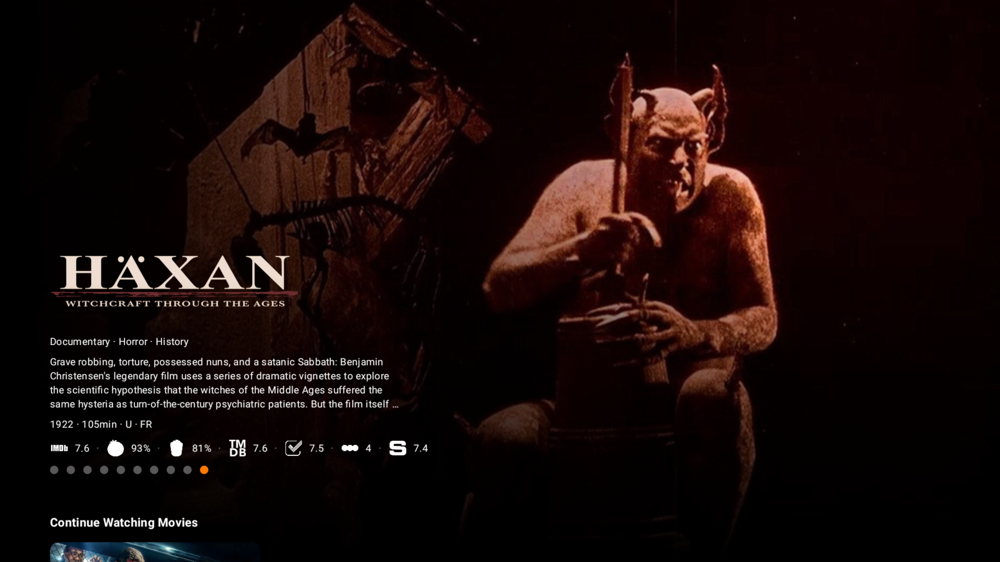
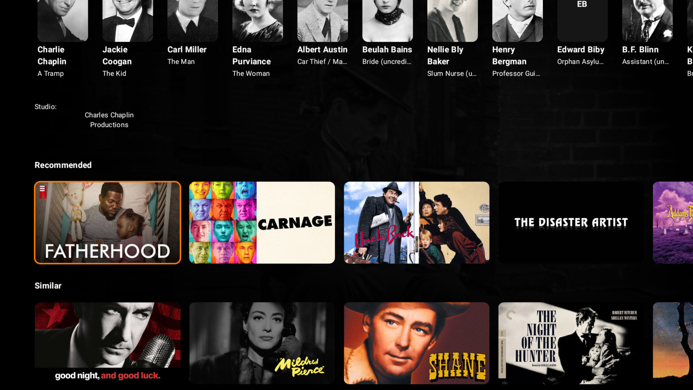
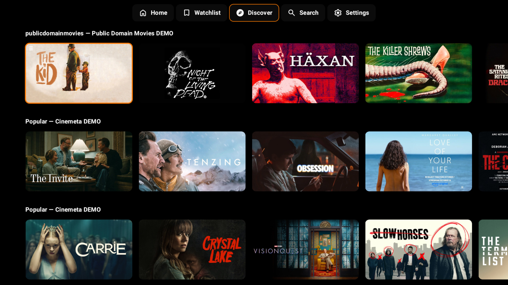
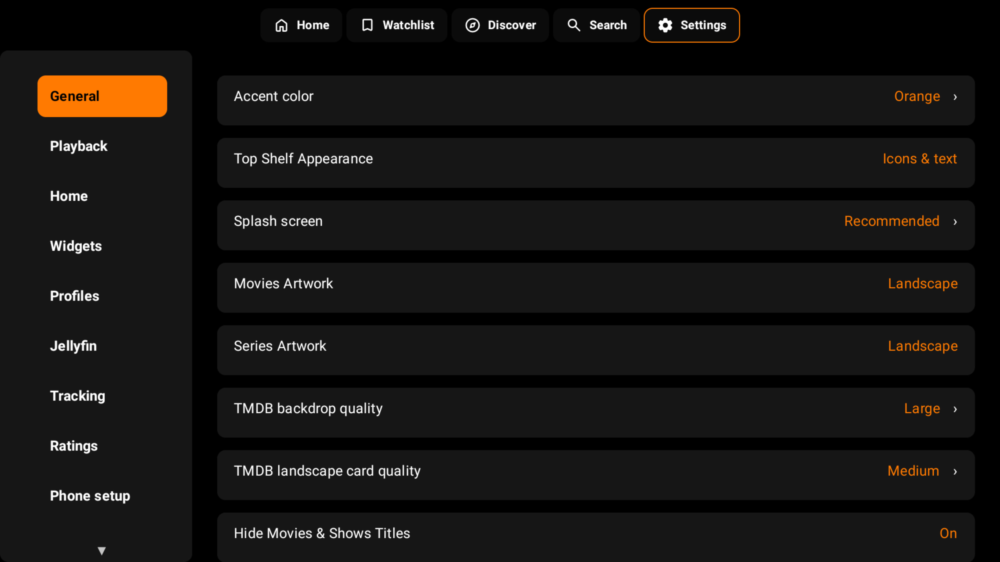
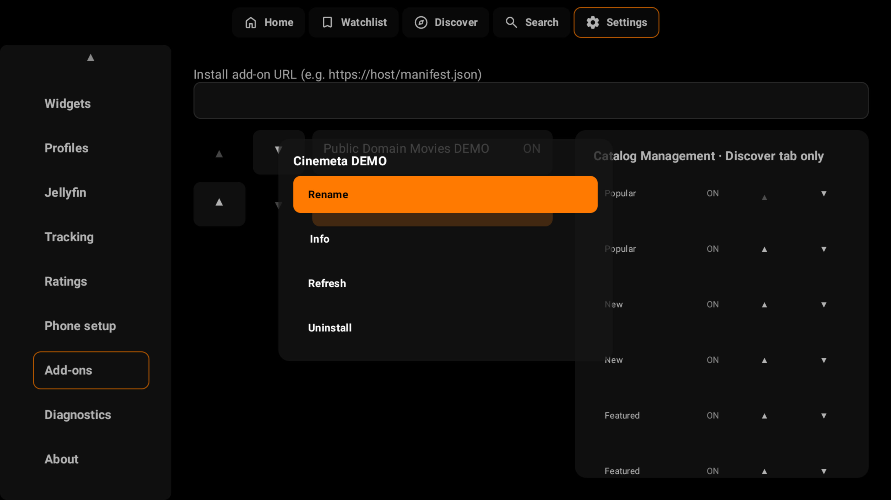

  

  <strong>Your media. Your way. Made for the big screen.</strong>

  A personal media player for Android TV, bringing your own Jellyfin libraries and the add-ons you choose into one TV-first experience.

  <a href="https://infusionplayer.stream/">Website</a> ·
  <a href="https://infusionplayer.stream/download/">Download</a> ·
  <a href="https://github.com/Addonniss/infusion-releases/releases">Releases</a>

## Install

**Using Downloader by AFTVnews**

1. Install [Downloader](https://play.google.com/store/apps/details?id=com.esaba.downloader) on your Android TV.
2. Enter the permanent INFUSION code:

<h2 align="center"><code>7197071</code></h2>

3. Open the [INFUSION download page](https://infusionplayer.stream/download/) shown in Downloader, download the latest TV version and follow Android's installation prompts.

You can also visit **[infusionplayer.stream/download](https://infusionplayer.stream/download/)** directly to get the installer.

## What is INFUSION today?

- **Home is yours.** A Spotlight hero you can link to your chosen Home row or turn off, plus Continue Watching, Up Next and Recently Watched. Show, hide, reorder and rename your rows.
- **Discover something new.** Explore trending, popular and top-rated movies and shows, or browse by genre. Choose which add-on catalogs appear and where.
- **Search your way.** Find titles and people, with search history remembered separately for each profile.
- **Rich details and context menus.** Explore artwork, reviews, directors, cast, similar titles and recommendations. Long-press cards for quick context actions.
- **Jellyfin and music.** Browse your own movies, shows, episodes and **music** libraries, with your watch state, music playback, queues and Now Playing. Optional **Radarr and Sonarr** connections are available in Settings for connection status.
- **Local-first watch state.** Keep your Watchlist and Recently Watched close at hand, with optional tracking through Trakt, Simkl and MDBList.
- **Playback made for TV.** Resume, seek, select audio and subtitles, adjust skip intervals and continue to the next episode, with HDR and Dolby Vision-aware presentation.
- **Add-ons in your control.** Install, enable, disable, restore, remove and rename Stremio-compatible add-ons, with context menus and control over their catalogs.
- **Personal profiles.** Give each profile its own presentation preferences.
- **Easier setup.** Enter credentials from your phone using a temporary local-network setup page instead of typing everything with a remote.

## Screenshots

| | |
|:---:|:---:|
|  |  |
| **Spotlight** | **Landscape cards** |
|  |  |
| **Poster cards** | **Movie details** |
|  |  |
| **Recommendations** | **Discover** |
|  |  |
| **Personalize** | **Manage add-ons** |

[View all 14 Android TV screenshots](assets/screenshots/tv/)

## Open Source

INFUSION's application source code is publicly available under the GNU General Public License v3.0 (GPLv3).

You can inspect, modify, and redistribute the GPL-covered source code under the terms of the license.

**[View Source Code](https://github.com/Addonniss/infusion-sources)** · **[GPLv3 License](https://github.com/Addonniss/infusion-sources/blob/main/LICENSE)**

This repository hosts official signed Android TV installers and release information. The application source code is maintained in the separate `infusion-sources` repository.

## Public alpha

INFUSION is currently in public alpha, and the experience is still evolving. For the latest build, changes and known issues, visit [GitHub Releases](https://github.com/Addonniss/infusion-releases/releases).

INFUSION is a media player, **not a content service**. It doesn't provide its own movies, shows, streams or bundled catalogs. You connect your own Jellyfin server and/or choose your own add-ons.

  <a href="https://infusionplayer.stream/support/">Support</a> ·
  <a href="https://infusionplayer.stream/privacy/">Privacy</a> ·
  <a href="SECURITY.md">Security</a> ·
  <a href="COPYRIGHT.md">Copyright</a> ·
  <a href="THIRD-PARTY-NOTICES.md">Third-party notices</a>

© 2026 INFUSION. Application source licensed under GPLv3. Official signed Android TV releases.

